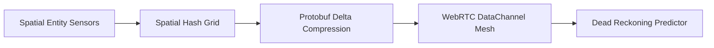

# visionflow-mesh

Distributed spatial telemetry mesh and dead reckoning synchronization engine for multi-agent industrial digital twins.

## Features

- **Spatial Hash Partitioning**: O(1) broad-phase spatial queries across massive industrial facilities.
- **Dead Reckoning Extrapolation**: Client-side trajectory prediction hiding up to 150ms of network latency.
- **Zero-Copy Protobuf Serialization**: Ultra-compact telemetry serialization for 60 Hz real-time multi-operator VR.

## License

MIT License (c) 2025-2026 Gaurav Bhardwaj / OmegaGaze Lab.
